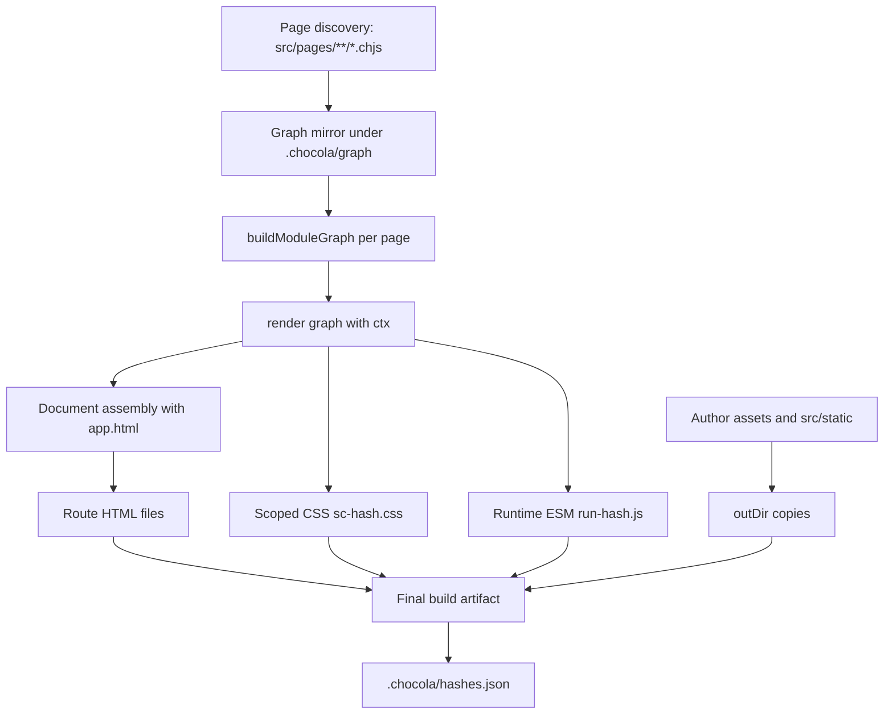
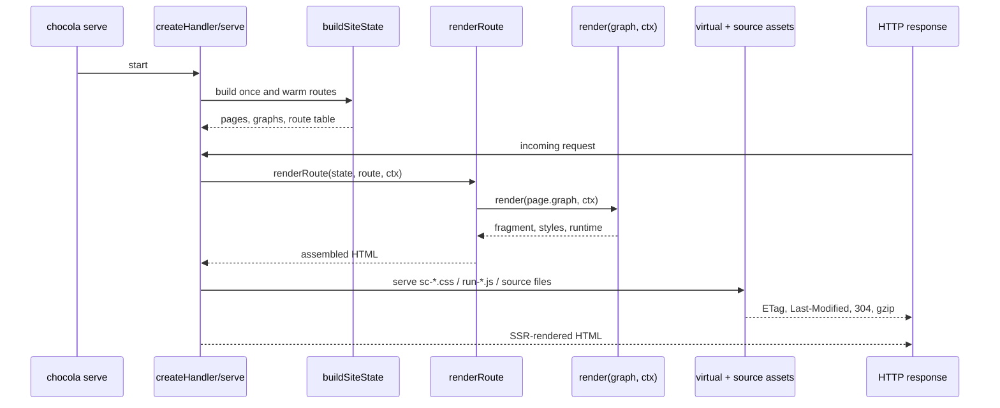

## SSG build pipeline

The static generation pipeline operates as a deterministic assembly line:

### Pipeline stages

1. **Page discovery** — Enumerate `.chjs` files under `src/pages/` (ignoring names that start with `_`). `index.chjs` maps to the folder root, and `pages/index.chjs` is required for `/`.
2. **Graph mirror** — Mirror `src/` under `.chocola/graph/`. Page-only directives such as `<chocolakit:head>` are extracted and removed before the core compiler reads the page.
3. **Module graph construction** — For each page, call Chocola's `buildModuleGraph(graphRoot, { entry })`. The graph follows explicit `.chjs` imports; files in `src/lib/` are not scanned automatically.
4. **Rendering** — Call Chocola's `render(graph, ctx)` for each route. The result contains the body fragment, scoped styles, runtime chunks, and a module-id hash map.
5. **Document assembly** — Insert the page head (interpolated with ctx and prop defaults), a content-hashed scoped stylesheet link, the body fragment, and runtime `<script type="module">` tags into `app.html`.
6. **Emission** — Write route HTML, `sc-<hash>.css`, `run-<hash>.js`, copied author assets, and `.chocola/hashes.json`.

### Determinism properties

- Component CSS scope id: `deterministicHash(moduleId, 8)` → 8-letter `a-z` string, stable across rebuilds.
- Scoped stylesheet filename: `sc-` plus `deterministicHash(styles, 6)` → content-derived, stable for identical CSS.
- Runtime chunk names: content-derived `run-<hash>.js` files.
- `hashMap` keys are module ids such as `pages/index.chjs` and `lib/card.chjs`.
- Author assets keep their original paths and are copied unchanged.

## Development server data flow

- **File watching** — Recursive `fs.watch` on `srcDir`, with a short debounce.
- **Atomic rebuild** — Build all routes, CSS, runtime chunks, and hashes into temporary maps. Swap the live state only after a successful rebuild; failed rebuilds keep the old state.
- **HMR protocol** — The injected browser client polls `/api/hot-reload`; a newer `buildTime` triggers `window.location.reload()`.
- **No dist output** — Dev responses and virtual assets are served from memory/disk store with `Cache-Control: no-store`.
- **No bundler** — ES modules are served natively; Chocola compilation output is the module graph.

## SSR per-request rendering

### Per-request flow

1. **Request reception** — Server honors `PORT` env variable; hostname defaults to `0.0.0.0` when `PORT` is set and no explicit hostname exists (container binding).
2. **Context construction** — `ctx` is built by merging:
   - Query parameters
   - Optional server-level `opts.ctx`
   - Middleware return values (context merge)
3. **Page rendering** — Kit reuses the route's graph and calls Chocola's `render(graph, ctx)` per request through `renderRoute`.
4. **Asset delivery** — Virtual assets (`sc-*` and `run-*`), source assets such as `/lib/format.js`, and `src/static` files are served with:
   - `ETag` and `Last-Modified` header generation
   - `304` not-modified response support
   - `gzip` compression for compressible content

### Configuration impact

- `server.port` and `server.hostname` from `chocola.config.json` or CLI flags
- `server.middleware` path resolved at handler initialization
