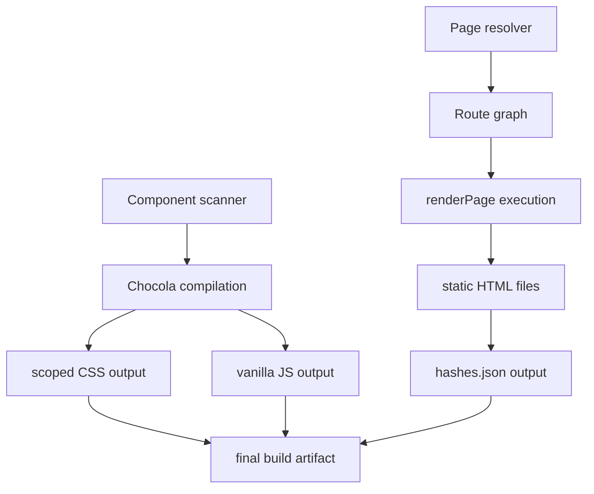
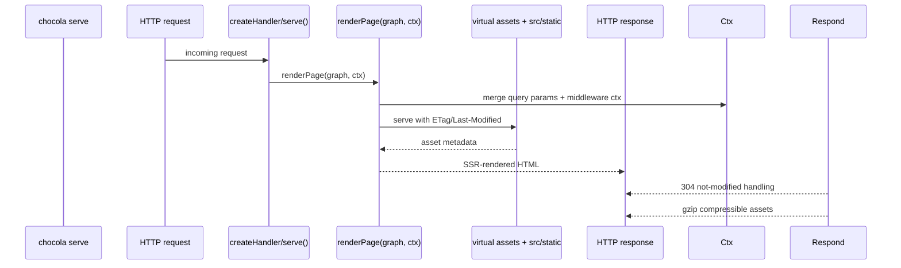

## SSG build pipeline

The static generation pipeline operates as a deterministic assembly line:

### Pipeline stages

1. **Component scanner** — Enumerates all `.html` files in `src/lib/`, producing a component list with file paths as keys.
2. **Chocola compilation** — Transforms each component into:
   - Scoped CSS with deterministic 8-letter hash (`a-z`), derived from component filename
   - Vanilla JavaScript module with corresponding hash
3. **Route graph construction** — Maps `src/pages/` file paths to URL paths using file-based routing rules (index files as folder roots, nested folders as path segments).
4. **renderPage execution** — For each resolved route, render the page markup inside `<chocolakit:body>` of `src/app.html`, injecting compiled CSS/JS references.
5. **Hash generation** — Write `.chocola/hashes.json` mapping component filenames to their deterministic hashes for downstream debugging.
6. **Asset finalization** — Output files named with deterministic hashes (`sc-<hash>.css`, `css-<hash>.css`, `js-<hash>.js`, `run-<hash>.js`). Hashes are stable across builds for identical content.

### Determinism properties

- Component CSS hash: `deterministicHash(componentName)` → 8-letter `a-z` string, stable across rebuilds
- Asset filename hash: content-derived, stable across rebuilds
- `hashes.json` is the source of truth for mapping output elements back to source components

## Development server data flow

- **Polling interval** — Default file change detection via polling
- **Incremental recompile** — Only components with changed files or dependencies are re-processed
- **HMR protocol** — Browser receives updated module graph via `/api/hot-reload` polling
- **No bundler** — ES modules served natively; Chocola compilation output is the module graph

## SSR per-request rendering

### Per-request flow

1. **Request reception** — Server honors `PORT` env variable; default hostname `0.0.0.0` when PORT is set (container binding).
2. **Context construction** — `ctx` is built by merging:
   - Route query parameters
   - Middleware return value (short-circuit or context merge)
3. **Page rendering** — `renderPage(graph, ctx)` executes per request, producing HTML.
4. **Asset delivery** — Virtual assets (`sc-*`/`run-*`/`css-*`/`js-*`) and `src/static` files are served with:
   - `ETag` and `Last-Modified` header generation
   - `304` not-modified response support
   - `gzip` compression for compressible content

### Configuration impact

- `server.port` and `server.hostname` from `chocola.config.json` or CLI flags
- `server.middleware` path resolved at handler initialization