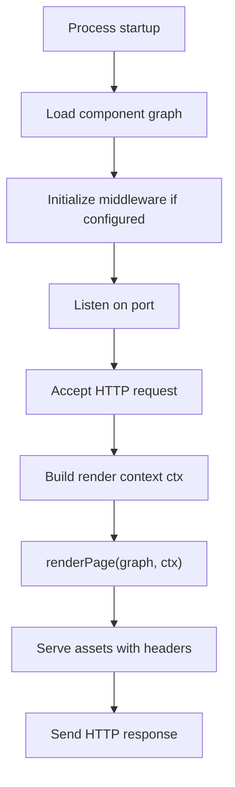

## Dev server architecture

### File watching and incremental rebuild

- **Polling mechanism** — File system polling at configurable intervals for change detection
- **Affected component scope** — On change, only components with modified files or dependencies are re-compiled
- **HMR pipeline** — Updated module graph delivered to browser via `/api/hot-reload` endpoint
- **No bundler dependency** — Browser receives ES modules directly from Chocola compilation output

### Architecture components

1. **Watcher** — Polls `src/` directories for `.html` file changes
2. **Compiler** — Re-runs Chocola compilation on affected components only
3. **Updater** — Pushes updated module identifiers to connected browsers
4. **Server** — Serves compiled assets and HMR updates on default port 3000

### Configuration points

- `dev.port` — Overrides default 3000
- `dev.hostname` — Binds to specific interface (default: `localhost`)
- Polling interval — Internal implementation detail, not user-configurable

## SSR production server architecture

### Handler lifecycle

### Per-request rendering flow

1. **Process initialization** — Load component compilation graph into memory. Initialize middleware if `server.middleware` is configured.
2. **Request acceptance** — Server listens on configured port (default 8080). Honors `PORT` environment variable for container deployment.
3. **Context construction** — For each request, build `ctx` by merging:
   - Route query parameters
   - Middleware return value (supports short-circuit `(req, res)` or `({ query, cookies, headers, url }) => ctx` pattern)
4. **Page rendering** — Execute `renderPage(graph, ctx)` to produce HTML. The component graph is shared across requests; only `ctx` varies per request.
5. **Asset serving** — Virtual assets (`sc-*`/`run-*`/`css-*`/`js-*`) and `src/static` files are served with:
   - `ETag` header based on file content hash
   - `Last-Modified` header based on file system timestamp
   - `304` not-modified response when `If-None-Match`/`If-Modified-Since` headers match
   - `gzip` content encoding when `Accept-Encoding` includes `gzip` and content is compressible
6. **Response delivery** — Send SSR-rendered HTML with appropriate headers.

### Middleware architecture

Default export of ESM module supporting two patterns:

- **Short-circuit** — Default export is `Array | Function | Object` that, when matched, short-circuits request processing
- **Context merge** — Default export is a function `({ query, cookies, headers, url }) => ctx` that merges custom context into the render pipeline

### PORT environment variable behavior

- When `PORT` is set and no explicit `--host` flag or `server.hostname` config exists, hostname defaults to `0.0.0.0` for container/container-orchestrator binding
- CLI flag `--host` takes precedence over `PORT` env for hostname determination
- `server.port` in config is always overridden by `PORT` env variable at runtime