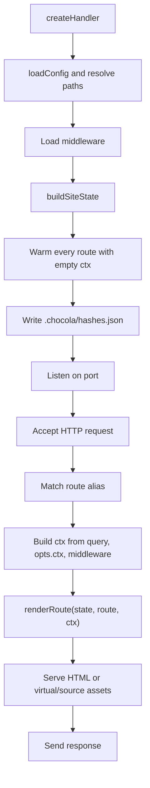

## Dev server architecture

### File watching and rebuilds

- **Watcher** — Recursive `fs.watch` on `srcDir`. Watcher events are ignored for `node_modules` paths.
- **Debounce** — Changes are coalesced with a 300 ms timer before a rebuild starts.
- **Atomic rebuild** — A rebuild constructs a complete next state (pages, graphs, scoped CSS, runtime chunks, hashes) in temporary maps. The live state is swapped only after the whole build succeeds. A failed rebuild logs the error and keeps serving the previous state.
- **Queueing** — If files change while a rebuild is running, one follow-up rebuild is queued; overlapping triggers never run concurrently.
- **No `dist` writes** — Dev renders pages and serves virtual assets from memory/disk caches. Nothing is written to `outDir`.
- **No bundler** — Browsers receive native ES modules from the Chocola compiler output.

### Architecture components

1. **Watcher** — Recursive `fs.watch` on `srcDir`, debounced to 300 ms.
2. **Builder** — Re-runs `buildSiteState` for the whole site and warms every route.
3. **Asset store** — `RuntimeStore` holds `run-<hash>.js` chunks; scoped `sc-<hash>.css` is served from the per-build state.
4. **HTTP server** — Serves HTML, virtual assets, and source/static files. Defaults to `localhost:3000`.

### Hot reload

An inline client script is injected before `</body>` in every rendered page. It polls `GET /api/hot-reload`:

```json
{ "buildTime": 1763150400000 }
```

When the returned `buildTime` is newer than the page's build time, the client calls `window.location.reload()`. All dev responses are sent with `Cache-Control: no-store`, so reloads always see the latest output. There is no partial CSS/JS hot-swap; a change reloads the page.

### Configuration points

- `dev.port` — Overrides default `3000`.
- `dev.hostname` — Binds to a specific interface (default `localhost`).
- `--open` — Opens the browser after startup.
- The debounce interval is an internal implementation detail.

## SSR production server architecture

### Handler lifecycle



### Startup

1. **Configuration** — `loadConfig` reads `chocola.config.json`, applies CLI overrides, and resolves `srcDir`, `outDir`, `pagesDir`, `appFile`, and `staticDir`.
2. **Middleware** — `server.middleware` (or the `--middleware` flag) is resolved relative to the project root and dynamically imported as ESM. A configured middleware file that does not exist throws at startup instead of being ignored.
3. **Site state** — `buildSiteState` discovers pages, mirrors the graph, and constructs one Chocola module graph per page.
4. **Warm-up** — Every route is rendered once with an empty `ctx`. This populates the virtual asset cache with invariant runtime chunks and scoped CSS, and builds the module-id hash map.
5. **Hash map** — The merged map is written to `.chocola/hashes.json` and attached to the handler for introspection.

### Per-request rendering flow

1. **Route matching** — The server looks up the pathname in the route table. Aliases include the clean route, the trailing-slash route, `.html` names, and file-path styles such as `/blog/index.html`.
2. **Context construction** — `ctx` starts from query parameters, then `opts.ctx`, then middleware return values. Middleware context wins over earlier values.
3. **Page rendering** — `renderRoute(state, route, ctx)` calls Chocola's `render(graph, ctx)` for the matched page. Graphs are shared across requests; only `ctx` changes.
4. **Asset ingestion** — The render result's `sc-<hash>.css` and `run-<hash>.js` chunks are added to the virtual file cache, and the hash map is updated.
5. **Response delivery** — HTML is sent with `ETag`, `Last-Modified`, `Content-Length`, and `Cache-Control: public, max-age=0, must-revalidate`.

### Asset serving

After route and virtual-asset lookups, the handler serves source assets:

- Files under `srcDir` (except `.chjs` sources and the configured `appFile`).
- An extensionless path also tries a `.html` file and a directory's `index.html`.
- If `staticDir` is configured outside `srcDir`, files are served from it as a fallback.

All files use the same response path:

- **`ETag`** — Weak validator derived from a SHA-256 hash of the file content.
- **`Last-Modified`** — File mtime (or the build time for virtual assets).
- **`304`** — Returned when `If-None-Match` matches the current `ETag`.
- **`gzip`** — Applied when the client accepts it and the MIME type is compressible; responses set `Vary: Accept-Encoding`.

Requests that match nothing get a plain `404` HTML response. Middleware and render failures produce `500` responses instead of crashing the process.

### Middleware architecture

The default export of the ESM middleware file may be an array, a function, or an object whose values are functions. All functions run in order for matched SSR routes.

- **Short-circuit** — A function declared with two parameters receives `(req, res)`. If it writes a response, Kit stops processing the request.
- **Context merge** — A function with fewer than two parameters receives a context object:

  ```js
  export default ({ query, cookies, headers, url, pathname, route, page }) => {
    return { user: null };
  };
  ```

  A returned plain object is merged into the render `ctx`. Returning `undefined`, a `Buffer`, or an array leaves `ctx` unchanged. Throwing produces a `500` response.

Middleware only runs for SSR routes, not for virtual or source asset requests.

### PORT environment variable behavior

Port precedence is:

```text
--port CLI flag > PORT environment variable > server.port config > 8080
```

When `PORT` is set and there is no explicit host flag or `server.hostname`/`server.host` config, the server binds to `0.0.0.0` for container deployment. An explicit host flag or configured hostname always wins over that default.
