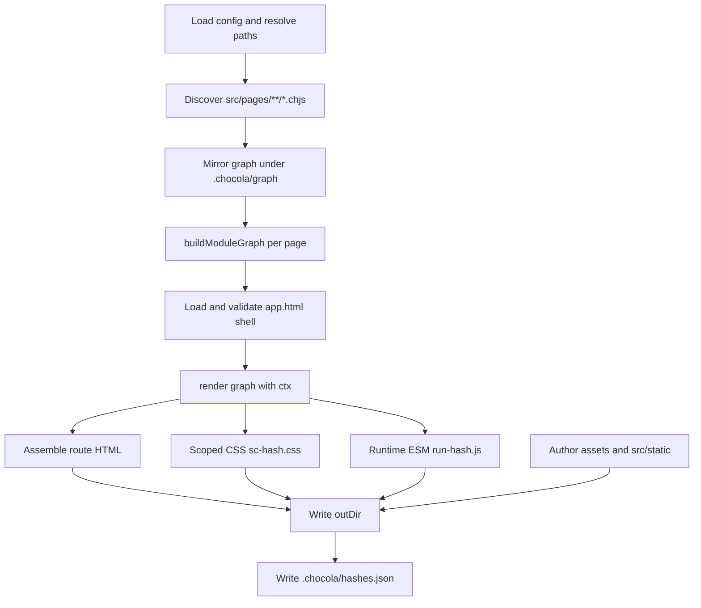

## Static SSG build architecture

### Build process pipeline



### Pipeline stages

1. **Configuration** — Load `chocola.config.json`, apply CLI overrides, and resolve all paths.
2. **Page discovery** — Enumerate `.chjs` files under `pagesDir`. `pages/index.chjs` is required for `/`. A `.html` page throws a migration error.
3. **Graph mirror** — Mirror source files under `.chocola/graph/` and strip page-only directives such as `<chocolakit:head>` before the core compiler reads them.
4. **Module graph construction** — Call `buildModuleGraph` per page. Imports determine the graph; there is no component scan.
5. **Shell validation** — Load `app.html`, require exactly one `<chocolakit:body>`, and allow at most one `<chocolakit:head>` inside `<head>`.
6. **Rendering** — Call `render(graph, ctx)` per route to produce the body fragment, scoped styles, runtime chunks, and module-id hash map.
7. **Emission** — Write route HTML, scoped CSS, runtime chunks, copied assets, and the hash map.

`emptyOutDir` controls whether `outDir` is cleaned before emission. Dev mode never writes `outDir`.

### Output artifacts

- `outDir/` — The deployable static tree:
  - Route HTML such as `index.html`, `about.html`, and `blog/index.html`
  - `sc-<hash>.css` — Content-hashed scoped component stylesheets
  - `run-<hash>.js` — Content-hashed ESM runtime chunks
  - Copied author assets — `src/static/` plus other non-`.chjs` source files, with their original paths
- `.chocola/hashes.json` — Module id → 8-letter scoped CSS id, for example:

  ```json
  {
    "lib/card.chjs": "fkffxyip",
    "pages/index.chjs": "zfamaczj"
  }
  ```

Global CSS is not emitted as `css-<hash>.css`. It stays an author-managed file linked from `app.html`, for example `<link rel="stylesheet" href="/styles.css">`. Kit copies it unchanged and only emits the generated scoped stylesheet.

### Deployment model

- The output is a static file tree suitable for any static host, CDN, or object storage.
- There is no runtime dependency on a ChocolaKit process after a static build.
- Content-hashed CSS and runtime filenames enable aggressive caching and cache busting.
- `.chocola/` is a local build cache/reference directory and is not part of the deployable output. Add it to `.gitignore`.

### Minimal build example

```sh
chjs build
# deploy the contents of dist/
```

## SSR production server deployment

### Process model

- A single long-running Node.js process listens on the configured port.
- At startup, `createHandler` calls `buildSiteState` and warms every route with an empty context. No separate build step is required between deployment and serving.
- The page module graphs, scoped CSS, runtime chunks, and hash map are retained in memory for request serving.
- `renderRoute` calls Chocola's `render(graph, ctx)` per request; only `ctx` varies.
- `server.middleware` is imported once at process start. A missing configured middleware file fails startup.

### Configuration-driven runtime

- `--port` wins over `PORT`, which wins over `server.port`, which wins over `8080`.
- When `PORT` is set and no explicit host is configured, the process binds to `0.0.0.0`.
- `server.hostname` (or `server.host`) and `server.middleware` come from `chocola.config.json` or CLI flags.

### Container deployment pattern

```dockerfile
FROM node:20-alpine
WORKDIR /app
COPY package.json package-lock.json ./
RUN npm install --omit=dev
COPY . .
EXPOSE 8080
CMD ["chjs", "serve"]
```

- The process binds to `0.0.0.0` when `PORT` is set and no explicit hostname is configured.
- Orchestrators (Kubernetes, Docker Swarm, and similar) can assign `PORT` at runtime.
- Health checks should target the listening port, ideally with a route that exists in `src/pages/`.

### Reverse proxy integration

When sitting behind nginx, Caddy, or similar:

```nginx
location / {
    proxy_pass http://localhost:8080;
    proxy_set_header Host $host;
    proxy_set_header X-Real-IP $remote_addr;
    proxy_set_header X-Forwarded-For $proxy_add_x_forwarded_for;
    proxy_set_header X-Forwarded-Proto $scheme;
}
```

- The SSR server handles `304` not-modified responses and `gzip` internally.
- A reverse proxy can terminate TLS.
- Asset caching headers from the SSR server can be complemented by proxy caching.

### SSG vs SSR deployment comparison

| Aspect | Static SSG | SSR production server |
|---|---|---|
| Runtime after deploy | None (static files only) | Node.js process required |
| Process model | File serving only | Per-request rendering + asset serving |
| Port configuration | Not applicable | `--port` > `PORT` > `server.port` > `8080` |
| Dynamic data | Build-time only | Per-request query params + middleware |
| Scaling | CDN-friendly, horizontal via load balancer | Multiple instances behind a load balancer |
| Roll strategy | Replace the static file tree | Deploy new process, then drain the old one |
