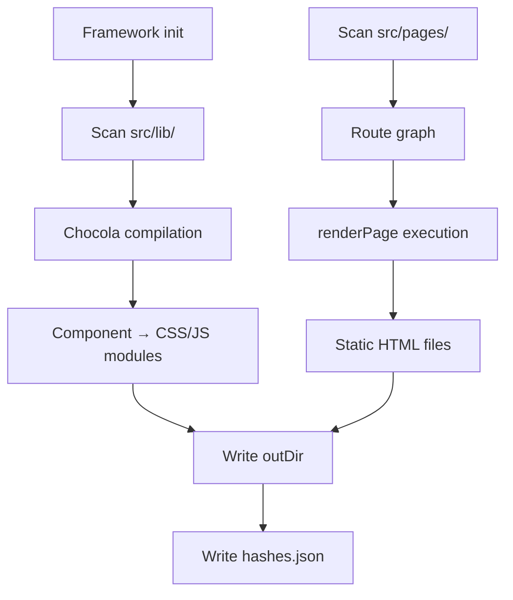

## Static SSG build architecture

### Build process pipeline



### Output artifacts

- `outDir/` — Contains all generated files:
  - HTML files for each resolved route
  - `sc-<hash>.css` and `css-<hash>.css` — Scoped and global CSS modules
  - `js-<hash>.js` and `run-<hash>.js` — Compiled JavaScript modules
  - `hashes.json` — Mapping of component filenames to deterministic hashes
- `.chocola/` — Excluded from build output; contains `hashes.json` for debugging

### Deployment model

- Output is a static file tree suitable for any static file host (CDN, object storage, etc.)
- No runtime dependency on ChocolaKit process after build
- Deterministic hashes enable aggressive caching and cache-busting strategies
- `emptyOutDir` control over idempotent rebuilds

### SSR production server deployment

### Process model

- Single long-running Node.js process listening on configured port
- Component graph retained in memory for request serving
- No build step required between deployment and serving

### Configuration-driven runtime

- `server.port` and `server.hostname` from config file or CLI overrides
- `server.middleware` ESM module loaded once at process start
- `PORT` environment variable honored at runtime for port overriding

### Container deployment pattern

```dockerfile
# Dockerfile example
FROM node:20-alpine
WORKDIR /app
COPY package.json package-lock.json ./
RUN npm install --production
COPY . .
EXPOSE 8080
CMD ["chocola", "serve"]
```

- Process binds to `0.0.0.0` when `PORT` env is set and no explicit hostname configured
- Orchestrator (K8s, Docker Swarm, etc.) assigns `PORT` at runtime
- Health checks can target the listening port

### Reverse proxy integration

When sitting behind nginx, Caddy, or similar:

```nginx
location / {
    proxy_pass http://localhost:8080;
    proxy_set_header Host $host;
    proxy_set_header X-Real-IP $remote_addr;
    proxy_set_header X-Forwarded-For $proxy_add_x_forwarded_for;
    proxy_set_header X-Forwarded-Proto $scheme;
}
```

- SSR server handles `304` not-modified and `gzip` internally
- Reverse proxy can offload TLS termination
- Asset caching headers from SSR can be complemented by proxy caching

### SSG vs SSR deployment comparison

| Aspect | Static SSG | SSR production server |
|---|---|---|
| Runtime after deploy | None (pure static files) | Node.js process required |
| Process model | File-serving only | Per-request rendering + asset serving |
| Port configuration | Static in built files | Configurable at startup via `PORT` env |
| Dynamic data | Build-time only | Per-request query params + middleware |
| Scaling | CDN-friendly, horizontal via load balancer | Single process; scale via multiple instances behind load balancer |
| Roll strategy | Replace static file tree | Redeploy new process; drain old before terminating new |